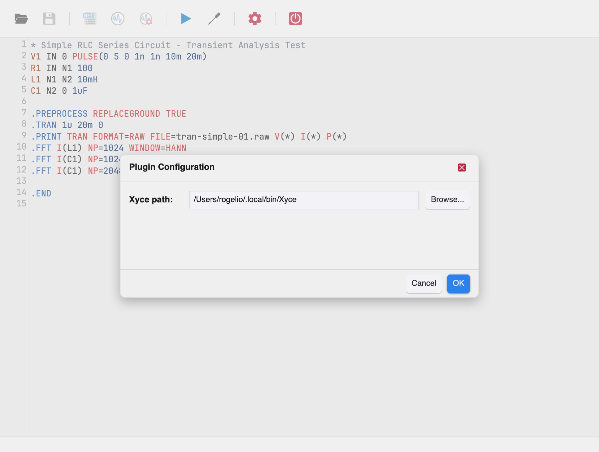

# Configuring the Xyce Executable

Xyce Studio runs simulations by driving the **Xyce** executable. Before
the first simulation you must tell it where that executable lives.

Open the configuration dialog with the **Plugin Settings** toolbar
tool.



- **Xyce path** — the full path to the Xyce executable.
- **Browse...** — opens a file picker to select the executable.

Click **OK** to save. The path is remembered across sessions.

## Parallel simulation

Xyce can be built with MPI support, which lets a large circuit spread across
several processes. Parallel support is compiled into the binary, and Xyce
reports it through its `-capabilities` flag:

```
% Xyce -capabilities              % Xyce.parallel -capabilities
Serial                             Parallel with MPI
Verilog-A derived (ADMS) models   Verilog-A derived (ADMS) models
...                               ...
```

Xyce Studio asks the configured binary what it was built with and shows the
answer directly under the path field. When the binary reports `Parallel with
MPI`, a **Run simulations in parallel** section appears below it.

- **Run simulations in parallel** — turn this on to run through an MPI
  launcher. A serial binary hides the section entirely, so a parallel run can
  never be started against a build that cannot perform one.
- **Launcher** — the MPI launcher, discovered on `PATH` as `mpirun` (falling
  back to its `mpiexec` alias) when the configuration holds none. **Browse...**
  selects a different one.
- **Processes** — how many copies of Xyce the launcher starts. A run is
  launched as `mpirun -np <count> Xyce <netlist>`, which is the form the Xyce
  User's Guide documents.
- **Arguments** — additional launcher options, inserted between the launcher
  and `-np`. Use this for `--oversubscribe`, `--hostfile`, `-x` or `--mca`
  settings.

### Process count and slots

The process count is limited by how many slots the launcher reports it can
offer, which is often **lower than the number of logical processors** — a
machine with 12 logical CPUs commonly offers 6 slots. Xyce Studio queries the
launcher for its slot count, shows it next to the spinner, and clamps the
count to it. Requesting more processes than the launcher has slots fails
before the simulation starts with:

```
There are not enough slots available in the system to satisfy the
20 slots that were requested by the application
```

To run more processes than there are slots, add `--oversubscribe` to the
**Arguments** field.

A launcher that reports fewer than two slots cannot start a parallel run at
all. The slot line is shown in orange to say so, and accepting the dialog
reports *“The MPI launcher reports fewer than two slots, so a parallel run
cannot start”*.

## Validation

The dialog refuses to accept:

- an empty path — *“Xyce executable path is required”*
- a file that is not an executable — *“Selected path is not an executable
  file”*
- a parallel run with no launcher path — *“MPI launcher path is required for a
  parallel run”*
- a parallel run whose launcher is not an executable — *“Selected MPI launcher
  is not an executable file”*
- a parallel run whose launcher reports fewer than two slots — *“The MPI
  launcher reports fewer than two slots, so a parallel run cannot start”*

Errors appear in red above the **Cancel**/**OK** buttons. **Cancel**,
**Escape**, or the ✕ button closes the dialog without saving.

## Running in parallel

A parallel run is reported and cancelled the same way a serial one is. Pressing
**Exit** sends `SIGTERM` to the launcher, which shuts down every process it
started. All simulator output still arrives in the console panel, and the exit
code reported by the launcher is the one Xyce produced.